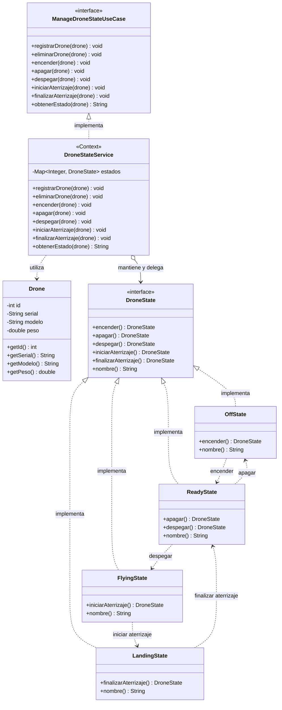

# Diagrama de clases: estados operativos del dron

El contexto del patrón State es `DroneStateService`: implementa el puerto de
entrada y mantiene el estado operativo por ID, sin añadir atributos ni cambiar
el modelo `Drone`.

Las operaciones no mostradas en una clase de estado se rechazan. Las transiciones
permitidas producen el estado siguiente; por eso el servicio no necesita
condicionales para decidir qué transición es válida.
